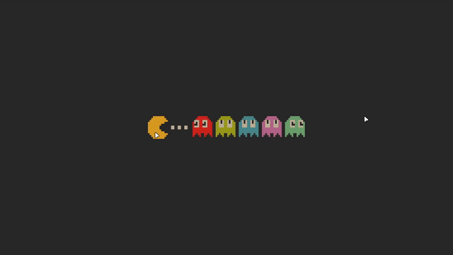

# coomer

A screen magnifier for Linux. Capture your screen once, then pan, zoom and inspect pixels.



## Features

- Smooth pan and zoom from 0.05× to 32×
- Overview navigation with Space and click-to-locate
- Pixel grid, coordinates, HEX colors and color copying
- Spotlight around the pointer
- X11, wlr-screencopy and portal capture backends

## Installation

### AppImage

Download the x86_64 or aarch64 AppImage from [releases](https://github.com/yuzujr/coomer/releases), make it executable, and run it. See [release notes](CHANGELOG.md).

Run the downloaded file with `--help` to check the available options. Without
FUSE, use `APPIMAGE_EXTRACT_AND_RUN=1`. On NixOS, use `appimage-run`.

Color copying also needs `wl-clipboard` on Wayland or `xclip` on X11, installed
separately and available in `PATH`. Other magnifier controls work without them.

### Arch Linux (AUR)

Install `coomer` (source) or `coomer-bin` (AppImage) with `paru` or `yay`:

```bash
paru -S coomer
```

### NixOS

Try without installing:

```bash
nix run github:yuzujr/coomer
```

Or add the flake to your configuration:

```nix
inputs.coomer.url = "github:yuzujr/coomer";

# In your NixOS module:
environment.systemPackages = [
  inputs.coomer.packages.${pkgs.system}.default
];
```

## Usage

```bash
coomer
coomer --list-monitors               # Find available output names (X11/wlr)
coomer --overlay                     # Wayland overlay
coomer --monitor HDMI-A-1             # Capture one output (X11/wlr)
coomer --monitor all                  # Capture all outputs (X11/wlr)
coomer --backend portal --portal-interactive  # Request the system capture dialog
coomer --help                        # All options
```

The captured image stays frozen while you inspect it. Quit and run coomer
again to take a new capture. Options with values accept both `--backend wlr`
and `--backend=wlr` syntax.

| Input | Action |
| --- | --- |
| Left drag | Pan |
| Scroll | Zoom |
| Hold Space | Overview; release to return |
| Left click in overview | Center that location at the previous zoom |
| 1 | Reset view |
| P | Toggle pixel inspection |
| C | Copy HEX color while inspecting |
| Hold Ctrl | Spotlight |
| Ctrl + scroll | Resize spotlight |
| Q / Escape | Quit |

Pixel inspection is off by default. Color copying requires `wl-clipboard` on
Wayland or `xclip` on X11. With `--monitor all`, pixel values refer to the
composited capture, which may be resampled on scaled outputs.

On Wayland, automatic capture selects the first available backend in this
order: wlr-screencopy, portal, X11. On X11, it uses X11. An error during the
capture stops the application; use `--backend wlr|portal|x11` to choose another
backend explicitly.

| Capture backend | Select/list outputs | Capture selection |
| --- | --- | --- |
| X11 | `--monitor`, `--list-monitors` | First output by default; `all` for the desktop |
| wlr-screencopy | `--monitor`, `--list-monitors` | First output by default; `all` for the desktop |
| Portal | System dialog | Use `--backend portal --portal-interactive` |

Portal does not support `--monitor` or `--list-monitors`. `--portal-interactive`
only affects the portal backend; pair it with `--backend portal` to request the
dialog even when wlr-screencopy is available. A misspelled output name reports
an error; copy a name from `--list-monitors`.

The wlr backend captures the first output by default. In niri, capture the
focused output with this command (requires `jq`):

```bash
coomer --overlay --monitor "$(niri msg -j focused-output | jq -r '.name')"
```

`--monitor` selects the capture; the compositor chooses the overlay output.
If layer-shell is unavailable, `--overlay` falls back to an xdg-shell fullscreen
window. Wayland fullscreen windows use the app ID `coomer` for desktop icons
and compositor rules.

For capture, display scaling, clipboard and AppImage issues, see
[troubleshooting](docs/troubleshooting.md).

## Build and Development

Requires Linux, a C17/C++17 compiler, CMake ≥3.18, Ninja, `pkg-config`, and
OpenGL/EGL development libraries. Backend dependencies:

| Backend | Dependencies |
| --- | --- |
| X11 | libX11, libXrandr |
| Wayland | wayland, wayland-egl, libxkbcommon, wayland-scanner |
| Portal | dbus |

```bash
# On Nix, enter the development environment first:
nix develop

cmake -S . -B build -G Ninja -DCMAKE_BUILD_TYPE=Release
cmake --build build --parallel
./build/coomer

# Optional system installation:
sudo cmake --install build --prefix /usr
```

All backends are enabled by default. Disable them with `-DCOOMER_X11=OFF`,
`-DCOOMER_WAYLAND=OFF` or `-DCOOMER_PORTAL=OFF` when configuring.

CMake generates `build/compile_commands.json` for clangd automatically. System
installation also installs the desktop entry, icon and Bash, fish and Zsh
completions. For a user-local installation, configure with
`-DCMAKE_INSTALL_PREFIX="$HOME/.local"`, build, then run `cmake --install build`
without `sudo`. Ensure `$HOME/.local/bin` is in `PATH`.

Navigation and momentum live in `src/app/ViewController.*`; the main loop
coordinates capture, windows and rendering. Both Wayland window types share
`src/window/WaylandInput.*` and `src/window/WaylandEglContext.*` for input and
EGL resource ownership.

Run tests with:

```bash
ctest --test-dir build --output-on-failure
```

The rendering test needs surfaceless EGL/OpenGL; set `LIBGL_ALWAYS_SOFTWARE=1`
for Mesa software rendering. Disable tests with `-DBUILD_TESTING=OFF`.

## Acknowledgements

Inspired by [boomer](https://github.com/tsoding/boomer) and
[woomer](https://github.com/coffeeispower/woomer).

## License

MIT.
