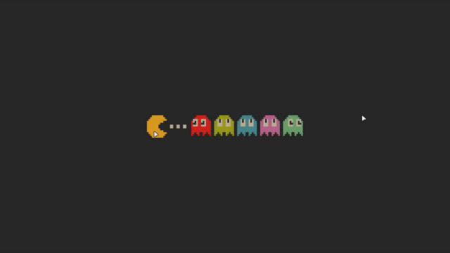

# coomer

Zoomer application for everyone on Linux.



## Features

- Smooth pan and zoom from 0.05× to 32×
- Overview navigation with Space and click-to-locate
- Pixel grid, coordinates, HEX colors and color copying
- Spotlight around the pointer
- X11, wlr-screencopy and portal capture backends

## Installation

### AppImage

Download the x86_64 or aarch64 AppImage from [releases](https://github.com/yuzujr/coomer/releases), make it executable, and run it. See [release notes](CHANGELOG.md).

Without FUSE, use `APPIMAGE_EXTRACT_AND_RUN=1`. On NixOS, use `appimage-run`.

### Arch Linux (AUR)

Install `coomer` (source) or `coomer-bin` (AppImage) with `paru` or `yay`:

```bash
paru -S coomer
```

### NixOS

Try without installing:

```bash
nix run github:yuzujr/coomer
```

Or add the flake to your configuration:

```nix
inputs.coomer.url = "github:yuzujr/coomer";

# In your NixOS module:
environment.systemPackages = [
  inputs.coomer.packages.${pkgs.system}.default
];
```

## Usage

```bash
coomer
coomer --overlay                     # Wayland overlay
coomer --monitor HDMI-A-1             # Capture one output (X11/wlr)
coomer --monitor all                  # Capture all outputs (X11/wlr)
coomer --portal-interactive           # Choose capture mode in the portal dialog
coomer --help                        # All options
```

| Input | Action |
| --- | --- |
| Left drag | Pan |
| Scroll | Zoom |
| Hold Space | Overview; release to return |
| Left click in overview | Center that location at the previous zoom |
| 1 | Reset view |
| P | Toggle pixel inspection |
| C | Copy HEX color while inspecting |
| Hold Ctrl | Spotlight |
| Ctrl + scroll | Resize spotlight |
| Q / Escape | Quit |

Pixel inspection is off by default. Color copying requires `wl-clipboard` on
Wayland or `xclip` on X11. With `--monitor all`, pixel values refer to the
composited capture, which may be resampled on scaled outputs.

On Wayland, automatic capture tries wlr-screencopy, then portal, then X11 if
available. On X11, it uses X11. Override with `--backend wlr|portal|x11`.
The portal does not support `--monitor`; use `--portal-interactive` to select
capture mode.

The wlr backend captures the first output by default. In niri, capture the
focused output with this command (requires `jq`):

```bash
coomer --overlay --monitor "$(niri msg -j focused-output | jq -r '.name')"
```

`--monitor` selects the capture; the compositor chooses the overlay output.

## Build and Development

Requires Linux, a C17/C++17 compiler, CMake ≥3.18, Ninja, `pkg-config`, and
OpenGL/EGL development libraries. Backend dependencies:

| Backend | Dependencies |
| --- | --- |
| X11 | libX11, libXrandr |
| Wayland | wayland, wayland-egl, libxkbcommon, wayland-scanner |
| Portal | dbus |

```bash
# On Nix, enter the development environment first:
nix develop

cmake -S . -B build -G Ninja -DCMAKE_BUILD_TYPE=Release
cmake --build build --parallel
./build/coomer

# Optional system installation:
sudo cmake --install build --prefix /usr
```

All backends are enabled by default. Disable them with `-DCOOMER_X11=OFF`,
`-DCOOMER_WAYLAND=OFF` or `-DCOOMER_PORTAL=OFF` when configuring.

CMake generates `build/compile_commands.json` for clangd automatically.

Run tests with:

```bash
ctest --test-dir build --output-on-failure
```

The rendering test needs surfaceless EGL/OpenGL; set `LIBGL_ALWAYS_SOFTWARE=1`
for Mesa software rendering. Disable tests with `-DBUILD_TESTING=OFF`.

## Acknowledgements

Inspired by [boomer](https://github.com/tsoding/boomer) and
[woomer](https://github.com/coffeeispower/woomer).

## License

MIT.
